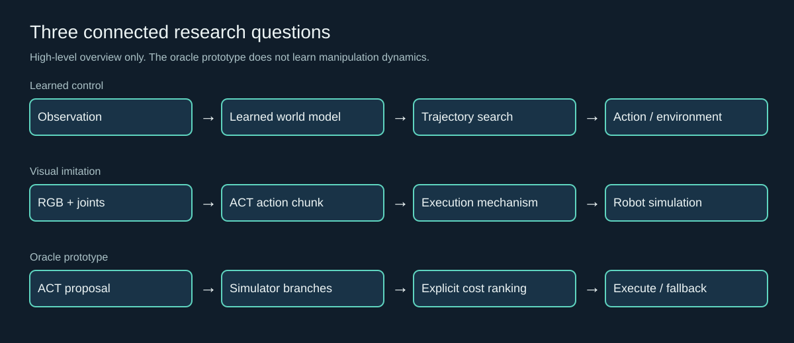
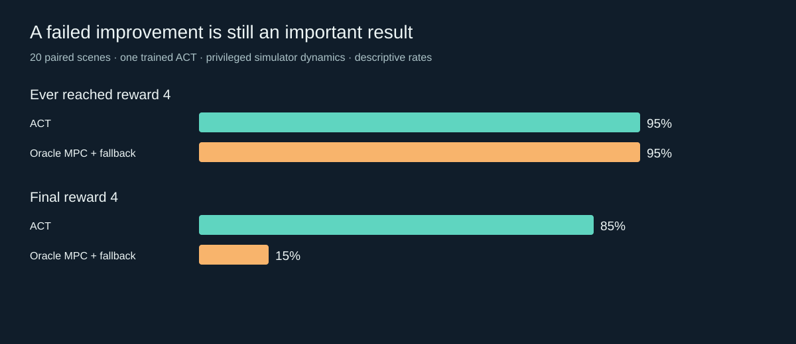

# Learning to control, learning when to plan

A research showcase of world-model control, visual imitation learning, and an ACT-prior MPC mechanism experiment. Prepared for research collaboration in embodied intelligence and physics-based simulation. This is **not** a novel rendering method or a validated real-robot system.

## Research questions
How much prediction horizon is worth its computational cost? Does more frequent feedback improve a learned action-chunk policy? Can simulator-based candidate ranking improve manipulation?

## Selected evidence
| Experiment | Completed evaluation | Finding |
|---|---|---|
| TD-MPC2 Walker reproduction | 3 training seeds, 2M control steps each; 9 held-out episodes | 993.46 ± 0.19 / 1000; standard deviation between trained-model means |
| Planning and budget studies | Two separate 108-episode matrices | Walker H2 had approximately 17% lower mean decision time than H3 with close returns in the same-device comparison; adaptive gating did not outperform the simple reference |
| ACT Transfer Cube | 50 scripted demonstrations, 10,000 updates, 50 paired scenes | Temporal ensemble: 90%; chunk execution: 86%; paired p=0.5, not a demonstrated success-rate improvement |
| Execution-stride study | 250 episodes, 50 new paired scenes | Strides 1/5/10/25/100: 0/6/26/38/82% success for one fixed policy |
| ACT + simulator MPC | 60 final episodes, 20 new paired scenes | ACT and MPC both reached 95% ever-success, but final success fell from 85% to 15%; this prototype failed to improve the baseline |

Different scene sets and devices must not be pooled to imply performance gains. ACT studies use one trained policy. Official reward-4 contact conditions are not a human-certified stable handover metric. MPC uses privileged simulator state and geometry, not a learned manipulation world model. Numerical branch differences and ACT fallback are part of the experiment. Earlier interrupted experiments are excluded from the final 60-episode matrix; they were retained for the private audit.

## Demonstrations
- [Walker: final trained policy](assets/walker.mp4) — 25 simulation seconds, 20 fps.
- [ACT: fixed-scene transfer](assets/transfer.mp4) — 8 simulation seconds, 50 fps.
- [MPC: fixed-scene failure](assets/mpc-failure.mp4) — reaches contact reward and later loses the object; deliberately retained rather than replacing it with a better-looking run.

These are actual recorded simulation episodes, not generated or scripted animation playback. ACT demonstrations used during training were produced by the official scripted teacher; the evaluated learned policies do not invoke that teacher. Simulation pauses while inference/planning runs; playback rate is not a real-time deployment claim.

## Contribution and attribution
The project work covers environment integration, training/evaluation orchestration, paired experiments, computation-budget analysis, prototype controller integration, numerical-consistency diagnostics, fallback auditing, reports and media preparation. Development used AI assistance; original TD-MPC2 and ACT algorithms are credited to their authors. No novel base algorithm is claimed. Simulator-based MPC is a mechanism prototype and a negative result, not a learned-world-model improvement.

## Next research questions
Study stable-grasp objectives and terminal values, audit multi-step model consistency, then investigate learned dynamics and uncertainty using newly collected training/validation data. Expand trained-policy seeds and evaluate on new held-out scenes. Existing held-out trajectories must not be reused for training and then relabeled independent tests.

## This repository
Only presentation documents, sanitized aggregate results, diagrams and selected rendered media are included. No training/planning implementation, model weights, raw trajectories, private data or original Git history is distributed. This showcase is evidence for discussion, **not an executable research reproduction package**. Materials outside this snapshot are not automatically authorized for release.

The static demo is `index.html`; it requires no installation, API keys, analytics or external JavaScript. A live Pages link will be added only after deployment is actually verified. See [DEPLOYMENT.md](DEPLOYMENT.md), [CREDITS.md](CREDITS.md), and [SECURITY.md](SECURITY.md).
